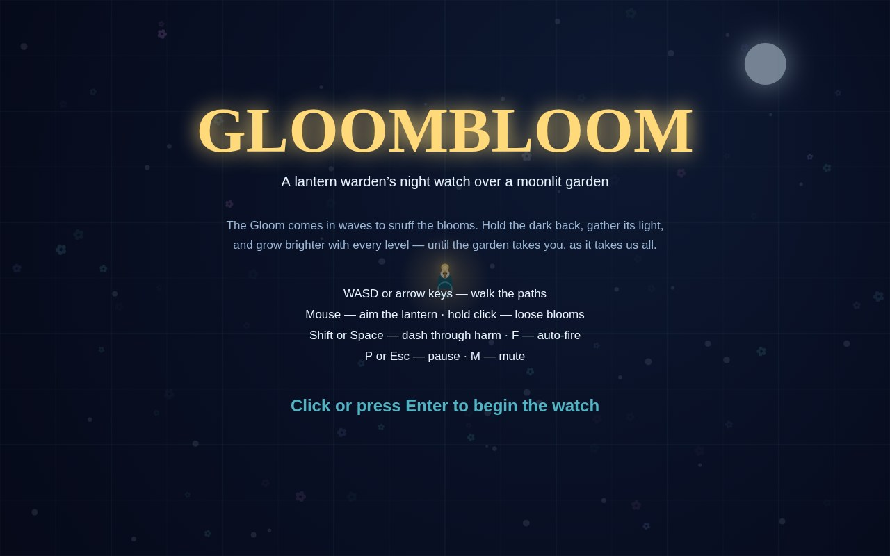

# GLOOMBLOOM

[](https://make.fun/bounty/best-game-01?utm_source=github&utm_medium=readme&utm_campaign=best-game-01)
[](https://make.fun/bounty/best-game-01/leaderboard?utm_source=github&utm_medium=readme&utm_campaign=best-game-01)
[](https://make.fun/bounty/best-game-01?utm_source=github&utm_medium=readme&utm_campaign=best-game-01)

An entry for the make.fun bounty [“Make the best game”](https://make.fun/bounty/best-game-01).

A twin-stick arena survival game in vanilla JavaScript and Canvas 2D — no libraries, no build step, no network requests: open it and play. You are the **Warden**, a small lantern-sprite keeping the night watch over a moonlit garden. Waves of **Gloom** spores drift in to snuff the blooms; scatter them with neon petals, gather the light motes they drop, and spend each level on a boon that makes your lantern brighter — harder hits, faster blooms, a piercing thorn, a periodic nova — until the garden takes you, as it takes us all.



## Play

```sh
node serve.ts          # serves game/ on http://localhost:8080
# or open game/index.html through any static file server
```

Needs a desktop browser and Node.js 22.18+ for the dev server and the hand-in program. Single player.

## The game

- **Five kinds of gloom** — chasers that walk at you, darters that zigzag in fast, spitters that hold their distance and spit back, splitters that divide when they die, and every fifth wave a **Gloomheart** boss with its own health bar and radial bursts of bolts.
- **Escalating waves** — each wave sends more gloom, a little harder than the last, with a breath of quiet between waves to gather your motes.
- **Light motes and levels** — kills drop glowing motes that fly to your lantern; each level pauses the night and offers three boon cards of nine (damage, fire rate, extra projectiles, piercing, speed, dash recharge, magnet reach, health, and the bloom nova).
- **A complete loop** — title screen, HUD (health, dash recharge, lantern level, wave, score and best), pause, game over with your tally, and one-click restart. Your best night is kept in `localStorage`.
- **Synthesized audio** — every shot, pop and chime, and the gentle night arpeggio underneath, are generated with WebAudio at play time; the game ships zero audio files.

## Controls

| Key | Action |
| --- | --- |
| W A S D / arrow keys | Walk the paths |
| Mouse | Aim the lantern |
| Hold left click | Loose blooms |
| Shift or Space | Dash (with cooldown) |
| F | Toggle auto-fire |
| 1 / 2 / 3 or click | Choose a boon on level-up |
| P or Esc | Pause |
| M | Mute |
| Enter or click | Start / play again |

## Layout of this repository

- `main.ts` — the hand-in program (Node 22): copies `game/` and `screenshots/` to the output directory and writes `dossier.json` with the vendored library.
- `vendor/makefun-game.ts` — the make.fun dossier library, vendored unchanged.
- `game/` — the playable game as static files: `index.html`, `styles.css`, and ES modules under `game/src/`, one job each — `main` (boot, loop, state machine), `config` (tuning and palette), `random` (seeded generator), `input`, `audio` (synthesized sound), `player` (the Warden), `enemies` (the Gloom and its waves), `projectiles`, `particles` (petals, rings and light motes), `upgrades` (the boon cards and the nova), `hud`, and `screens` (the garden and the title, pause and game-over screens).
- `screenshots/` — real renders of the game, staged deterministically by its `?shot=title|play|upgrade|over&seed=1` modes (`shots.json` lists them).
- `serve.ts` — a tiny static server for local play.

## License

MIT — see `LICENSE`.
